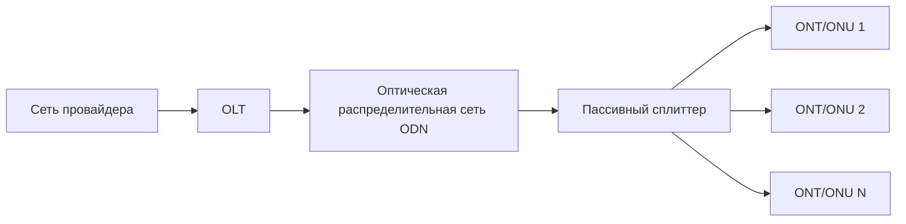
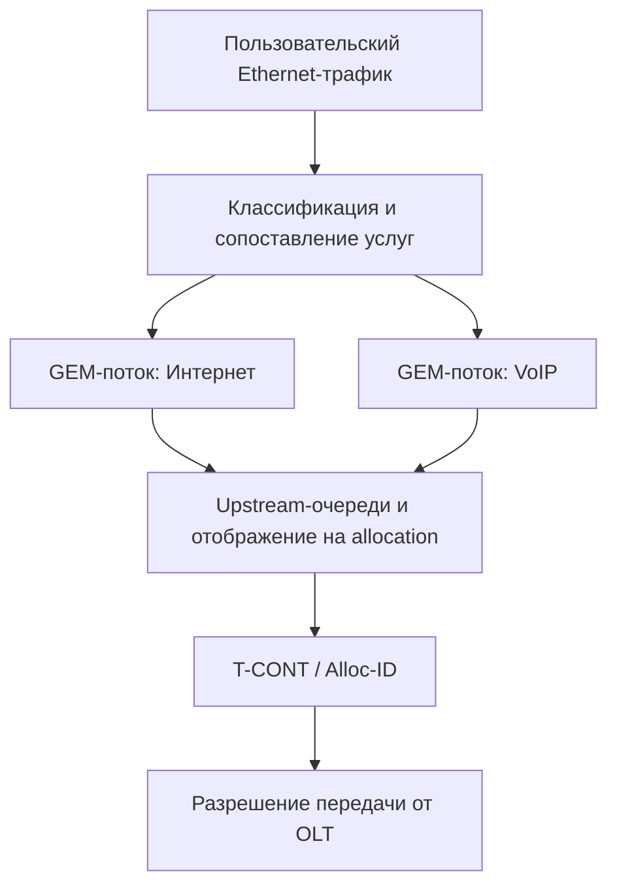
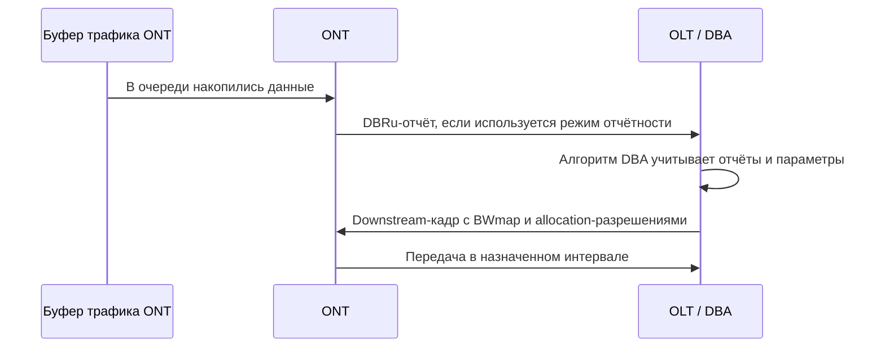
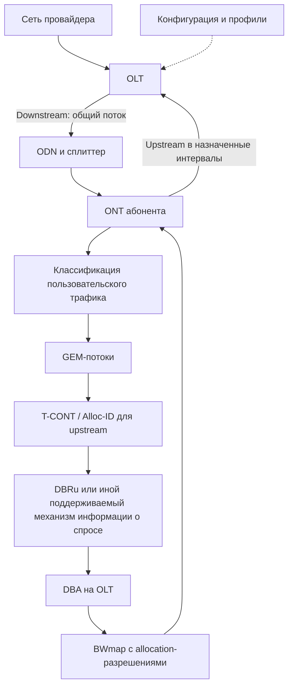

# Учебник GPON: архитектура, передача данных, T-CONT, DBA и профили

> **Назначение пособия.** Вводный учебный материал для понимания GPON и базовой логики настройки оборудования доступа. Стандарт описывает протоколы и поведение сети; названия профилей, команды CLI и детали интерфейса управления зависят от производителя OLT/ONT.

## Оглавление

1. Что такое GPON
2. Архитектура сети
3. Физический уровень: длины волн, скорости и кадры
4. Как организован трафик: GEM, Alloc-ID и T-CONT
5. Пять типов T-CONT
6. Upstream-планирование: DBRu, DBA и BWmap
7. Профили и параметры услуг
8. Регистрация ONT и запуск услуги
9. Практический пример прохождения трафика
10. Типичные заблуждения и ошибки
11. Словарь терминов
12. Контрольные вопросы
13. Краткая схема всей системы
14. Источники для дальнейшего изучения

---

## 1. Что такое GPON

**GPON** (Gigabit-capable Passive Optical Network) — технология пассивной оптической сети доступа семейства PON. Она позволяет одному порту OLT обслуживать несколько абонентских терминалов через оптическую распределительную сеть и пассивные делители — сплиттеры.

Слово **пассивная** означает, что между OLT и ONT в оптической распределительной сети (ODN) обычно нет питаемых активных устройств, выполняющих коммутацию или регенерацию сигнала. Сам OLT и ONT, разумеется, требуют питания.

### Чем GPON отличается от Ethernet «точка-точка»

| Характеристика | Ethernet point-to-point | GPON |
|---|---|---|
| Топология доступа | Обычно отдельный линк до каждого абонента | Одно дерево PON с общим сегментом и пассивными разветвителями |
| Разделение среды | Отдельный порт/линк | Общая оптическая среда; downstream широковещательный, upstream расписан по времени |
| Активное оборудование | Зависит от архитектуры; часто коммутатор ближе к абоненту | OLT и ONT активны, сплиттер пассивен |
| Пропускная способность | Зависит от скорости каждого линка и агрегации | Скорость PON-порта разделяется между одновременно активными абонентами |
| Планирование upstream | Для отдельного Ethernet-линка обычно не нужно PON-планирование | OLT назначает временные разрешения передачи |

**Важно:** GPON не означает, что каждый абонент постоянно получает полную линейную скорость PON. Абоненты используют общий ресурс, а фактическая скорость услуги дополнительно ограничивается тарифом, профилями, загрузкой и возможностями оборудования.

### Что даёт пассивная распределительная сеть

- меньше активных узлов и точек отказа на участке доступа;
- отсутствие необходимости подавать питание на сплиттер;
- возможность подключать множество ONT к одному PON-порту.

При этом сплиттер вносит оптические потери. Чем выше коэффициент деления, тем меньше оптической мощности приходится на каждый выход. Дальность зависит не только от расстояния, но и от класса оптического бюджета, потерь в волокне, соединителях, сварках и сплиттерах.

---

## 2. Архитектура сети

### 2.1 Основные элементы

| Элемент | Расположение | Функция |
|---|---|---|
| **OLT** (Optical Line Terminal) | Узел/станция провайдера | Управляет PON, принимает upstream, передаёт downstream, назначает upstream-разрешения и управляет терминалами |
| **ODN** (Optical Distribution Network) | Между OLT и абонентами | Волокна, сплиттеры, соединители, сварки и другие пассивные компоненты |
| **Сплиттер** | Узел распределения, шкаф, муфта, здание | Пассивно делит оптическую мощность downstream и объединяет сигналы upstream |
| **ONU/ONT** | У абонента или рядом с ним | Завершает PON и предоставляет пользовательские интерфейсы: Ethernet, телефон, иногда Wi-Fi и другие |

**ONU** (Optical Network Unit) — общее название сетевого терминала. **ONT** (Optical Network Terminal) часто называют терминал, установленный у конечного абонента. В повседневной речи эти термины нередко используют как синонимы; конкретное употребление зависит от контекста и производителя.

### 2.2 Что означает делитель 1:32 или 1:64

Обозначение 1:32 означает один вход и 32 выхода. Это не обещание, что на каждом выходе будет одинаковая полезная скорость или что сеть всегда сможет обслужить ровно 32 абонента на максимальной скорости тарифа. Число подключений выбирают с учётом оптического бюджета, планируемой загрузки и требований оператора.

---

## 3. Физический уровень: длины волн, скорости и кадры

### 3.1 Два направления по одному волокну

В типичной одно-волоконной GPON-системе направления разделяются по длинам волн с помощью WDM:

- **Downstream (OLT → ONT):** обычно около **1490 нм**; стандартный диапазон downstream для одно-волоконной системы — 1480–1500 нм.
- **Upstream (ONT → OLT):** обычно около **1310 нм**; стандартный диапазон upstream — 1260–1360 нм.

Это позволяет передавать данные в обоих направлениях по одному волокну. В отдельных вариантах оборудования и схемах могут использоваться дополнительные длины волн для других услуг.

### 3.2 Линейные скорости GPON

Для наиболее распространённого асимметричного режима GPON номинальные скорости линии:

| Направление | Номинальная линейная скорость |
|---|---:|
| Downstream | 2,48832 Гбит/с |
| Upstream | 1,24416 Гбит/с |

Семейство GPON также предусматривает другие варианты скоростей upstream. Поэтому корректнее говорить о типичном режиме, а не утверждать, что любой возможный GPON-профиль имеет только одну комбинацию скоростей.

Это **скорости линии**, а не гарантированная полезная скорость одного абонента. Часть ресурса используется протокольными заголовками и служебными механизмами; пропускная способность также разделяется между абонентами.

### 3.3 Downstream: общий поток и логическая фильтрация

OLT передаёт downstream-кадры, доступные всем ONT в соответствующем PON-дереве. Терминалы обрабатывают адресованные им логические потоки и отбрасывают не предназначенные им данные. Для защиты пользовательских данных применяется предусмотренный GPON механизм шифрования downstream, когда он настроен и поддерживается.

**GEM Port ID** помогает идентифицировать GEM-поток. Это не то же самое, что Alloc-ID: GEM Port ID относится к логическому потоку GEM, а Alloc-ID используется для идентификации upstream-распределения, связанного с T-CONT.

### 3.4 Upstream: TDMA и разрешения OLT

В upstream несколько ONT используют общий оптический путь. Чтобы их передачи не накладывались друг на друга, OLT назначает терминалам временные разрешения (grants). ONT передаёт только в выделенные интервалы.

Кадр GPON имеет период **125 мкс** — это соответствует 8000 кадрам в секунду. Но не следует представлять каждый кадр как три-четыре фиксированных слота для конкретных ONT: BWmap может описывать множество allocation-структур и разрешений для разных Alloc-ID.

---

## 4. Как организован трафик: GEM, Alloc-ID и T-CONT

Для понимания GPON важно не смешивать три разных сущности.

### 4.1 GEM Port

**GEM** (GPON Encapsulation Method) — механизм инкапсуляции пользовательских данных. **GEM Port** — логический поток, обозначаемый GEM Port ID. С его помощью можно разделять разные потоки/услуги и направлять данные по соответствующей логике обработки.

Пример: Ethernet-трафик абонента может быть сопоставлен с GEM-потоком, а затем передан через соответствующий upstream-контекст.

### 4.2 T-CONT и Alloc-ID

**T-CONT** (Transmission Container) — логическая сущность, используемая при распределении полосы upstream. OLT планирует передачу, опираясь на Alloc-ID и параметры трафика, настроенные для соответствующего распределения.

**Alloc-ID** (Allocation Identifier) — идентификатор, по которому в GPON обозначается allocation-контекст upstream. На практике он связан с T-CONT, но важно понимать разницу терминов: T-CONT — логическая сущность/контейнер передачи, Alloc-ID — её идентификатор в механизме распределения полосы.

### 4.3 Как связаны GEM Port, T-CONT и ONT

- Один ONT может иметь несколько GEM-потоков.
- Потоки услуг классифицируются и сопоставляются с соответствующими логическими каналами передачи.
- Upstream-ресурс выделяется через allocation, связанный с T-CONT/Alloc-ID.
- Нельзя считать, что каждому GEM Port обязательно соответствует отдельный T-CONT: взаимное отображение определяется конфигурацией и возможностями системы.

Упрощённая иллюстрация:

**Главное различие:** GEM описывает логический поток данных, а T-CONT/Alloc-ID — контекст выделения полосы upstream. Это связанные, но не взаимозаменяемые понятия.

---

## 5. Пять типов T-CONT

В стандарте описаны пять распространённых типов T-CONT. Тип — удобная классификация комбинации параметров трафика; фактический алгоритм OLT опирается на настроенные параметры полосы, а не на одно только название типа.

| Тип | Характеристика | Типичное применение |
|---|---|---|
| **Type 1** | Только Fixed bandwidth | Трафик с жёсткими требованиями к задержке/джиттеру и предсказуемой скоростью |
| **Type 2** | Только Assured bandwidth | Трафик, которому нужна гарантированная составляющая полосы, но не обязательно жёсткий временной профиль |
| **Type 3** | Assured bandwidth плюс возможность получать Non-Assured bandwidth | Переменный пакетный трафик с гарантированной базовой скоростью |
| **Type 4** | Best Effort, без Fixed и Assured составляющих | Негарантированный трафик, который использует доступный остаточный ресурс |
| **Type 5** | Комбинация компонентов полосы; наиболее универсальный тип | Сценарии, в которых нужны несколько составляющих распределения полосы |

### 5.1 Что означают компоненты полосы

- **Fixed bandwidth** — ресурс, заранее выделяемый согласно настроенной конфигурации; не следует трактовать его как «данные всегда передаются даже при пустой очереди» без учёта деталей реализации.
- **Assured bandwidth** — гарантированная составляющая ресурса в рамках условий и параметров системы.
- **Non-Assured bandwidth** — дополнительная полоса, на которую может претендовать соответствующий тип T-CONT после выполнения более строгих требований.
- **Best Effort** — ресурс, доступный по остаточному принципу и не являющийся гарантированной полосой.

Точные названия полей и правила настройки в интерфейсе OLT могут отличаться. Необходимо читать документацию конкретного производителя.

### 5.2 Важное уточнение о Type 5

Type 5 не означает «все услуги автоматически получают правильный приоритет в одной очереди». Он позволяет описывать более общую комбинацию компонентов полосы. Приоритеты пакетов, классификация услуг, очереди, ограничения скорости и отображение потоков на T-CONT требуют отдельной настройки в соответствии с архитектурой конкретного оборудования.

---

## 6. Upstream-планирование: DBRu, DBA и BWmap

### 6.1 Три разных механизма

**DBRu** (Dynamic Bandwidth Report upstream) — отчёт ONT о состоянии соответствующего логического буфера, используемый механизмом DBA в режиме статусной отчётности.

**DBA** (Dynamic Bandwidth Assignment) — механизм/алгоритм динамического распределения полосы. Он принимает решения о распределении доступного upstream-ресурса с учётом отчётов, параметров трафика и политики OLT.

**BWmap** (Bandwidth Map) — карта распределения полосы в downstream-кадре GPON. Она содержит allocation-структуры, определяющие, каким Alloc-ID и в каких временных границах разрешена upstream-передача.

### 6.2 Упрощённый цикл работы

**Это логическая модель, а не жёсткая последовательность, повторяющаяся в каждом кадре.** В зависимости от режима DBA, конфигурации и реализации могут применяться статусная отчётность, мониторинг трафика или другие предусмотренные стандартом механизмы. Отчёт и выдача разрешения не обязаны составлять простую пару «отчёт в кадре N — передача строго в кадре N+1».

### 6.3 Пошагово

1. **Поступление данных.** ONT принимает пользовательский трафик, классифицирует его и помещает в соответствующие очереди.
2. **Информация о спросе.** При использовании status-reporting ONT передаёт DBRu, указывающий объём данных в логическом буфере, связанном с соответствующим Alloc-ID.
3. **Расчёт на OLT.** DBA учитывает спрос, гарантированные и максимальные параметры, доступный ресурс PON и политику планирования.
4. **Назначение ресурса.** OLT включает разрешения в BWmap, указывая Alloc-ID и временные параметры передачи.
5. **Передача.** ONT отправляет данные только в разрешённые интервалы.
6. **Повторная оценка.** Планирование продолжается на следующих кадрах с учётом изменившегося спроса и состояния сети.

DBRu — не команда «дай мне ровно столько мегабит», а информация о состоянии буфера. Конкретное решение принимает DBA на стороне OLT.

### 6.4 Почему upstream не сталкивается

ONT не выбирает произвольно момент передачи. Он использует назначенные OLT интервалы. Синхронизация и ranging помогают учитывать различия в расстоянии до терминалов, чтобы передачи приходили в ожидаемых временных границах.

DBA может перераспределять доступный ресурс, но не создаёт дополнительную физическую пропускную способность. Если суммарный спрос выше доступного ресурса, часть трафика будет ожидать в очередях, а задержка может увеличиться.

---

## 7. Профили и параметры услуг

Слова **DBA profile**, **line profile**, **service profile** и **ONT profile** удобны для обучения, но это не единый универсальный набор объектов с одинаковыми именами во всех OLT. В разных вендорских системах структура профилей и их связи различаются.

### 7.1 Параметры DBA

Обычно к настройкам, влияющим на upstream-планирование, относятся:

- тип/набор компонентов T-CONT;
- Fixed, Assured, Non-Assured и Maximum bandwidth — если эти поля предусмотрены платформой;
- привязка к Alloc-ID или создание allocation при активации ONT;
- параметры отчётности и политики DBA, если они доступны для настройки;
- ограничения и приоритеты, которые влияют на обслуживание трафика.

**Maximum** — верхняя граница для соответствующего контекста/потока согласно реализации, а не дополнительная гарантия полосы.

### 7.2 Line profile / параметры линии

В зависимости от оборудования этот профиль может определять часть параметров PON и/или ONT, например:

- состав и параметры T-CONT/GEM в терминале;
- параметры FEC, если они управляются на этом уровне;
- параметры, связанные с линией и возможностями ONT.

Не следует автоматически считать, что line profile везде задаёт скорость GPON, дальность и все физические параметры. Линейная скорость определяется режимом и возможностями PON-порта, а допустимая дальность — оптическим бюджетом и требованиями стандарта.

### 7.3 Service profile / сервисная конфигурация

Может включать или связывать:

- VLAN и режимы обработки тегов;
- сопоставление пользовательских портов с услугами;
- QoS, классификацию и приоритеты;
- ограничения скорости на услугу или порт;
- привязку услуг к GEM-потокам.

Конкретное разделение между service profile, traffic profile и другими объектами зависит от производителя.

### 7.4 ONT profile / шаблон терминала

Вендорский профиль терминала может описывать его порты и сервисные возможности:

- Ethernet-порты;
- телефонные порты POTS;
- Wi-Fi и другие локальные интерфейсы, если они управляются OLT;
- привязки услуг и параметры управления.

Наличие Wi-Fi или USB в устройстве само по себе не означает, что этими функциями управляет профиль OLT.

### 7.5 Как читать конфигурацию профилей

При разборе конфигурации полезно задавать четыре вопроса:

1. **Как терминал регистрируется и идентифицируется?**
2. **Какие upstream-ресурсы выделены и по каким правилам DBA их распределяет?**
3. **Как пользовательский трафик классифицируется и сопоставляется с GEM/VLAN/QoS?**
4. **Какие ограничения скорости применяются и на каком уровне?**

Необходимо отличать лимит услуги от гарантированной полосы PON. Например, тариф «300 Мбит/с» может быть реализован ограничением трафика на пользовательском сервисе; это не обязательно означает Assured bandwidth в 300 Мбит/с на T-CONT.

---

## 8. Регистрация ONT и запуск услуги

Активация ONT — это не просто приветственное сообщение и применение четырёх профилей в фиксированном порядке. Это процедура обнаружения и активации терминала по GPON, после которой OLT и система управления настраивают необходимые параметры.

В упрощённом виде процесс выглядит так:

1. **Подключение и обнаружение.** OLT обнаруживает новый терминал в соответствии с процедурой активации GPON.
2. **Измерение задержки / ranging.** Система определяет временные параметры, необходимые для корректного upstream.
3. **Идентификация и регистрация.** OLT идентифицирует ONT, например по серийному номеру и данным конфигурации; конкретные методы авторизации зависят от оборудования и политики оператора.
4. **Назначение идентификаторов и ресурсов.** Терминалу назначаются необходимые логические идентификаторы и allocation-контексты.
5. **Управление ONT.** OMCI и/или механизмы производителя используются для настройки поддерживаемых сущностей, портов, GEM-потоков и услуг.
6. **Настройка сервисов.** Применяются VLAN, QoS, ограничения скорости и другие параметры согласно конфигурации.
7. **Проверка.** Контролируют состояние PON, оптические уровни, регистрацию, VLAN, выдачу адреса и прохождение трафика.

Порядок, названия шагов и степень автоматизации зависят от OLT/ONT и системы управления. Профиль в интерфейсе OLT может быть шаблоном, из которого создаётся конфигурация, а не самостоятельным сообщением протокола GPON.

---

## 9. Практический пример прохождения трафика

Предположим, абонент подключён к ONT, а его интернет-услуга использует VLAN и ограничение скорости. Названия VLAN, Alloc-ID и параметры ниже условны и приведены для объяснения принципа.

### 9.1 Upstream: от абонента к сети провайдера

1. Компьютер отправляет Ethernet-кадр в ONT.
2. ONT классифицирует трафик по настроенным правилам: порт, VLAN, приоритет или другие признаки.
3. Трафик сопоставляется с настроенным GEM-потоком и соответствующей логикой upstream-передачи.
4. Данные ожидают в очереди, связанной с allocation/T-CONT.
5. OLT получает информацию о спросе через предусмотренный режим DBA и/или использует поддерживаемые механизмы мониторинга.
6. DBA принимает решение о выделении ресурса с учётом параметров и доступной полосы.
7. OLT передаёт BWmap с разрешениями.
8. ONT отправляет данные в назначенном временном интервале.
9. OLT принимает трафик и направляет его в сеть провайдера согласно конфигурации услуги.

### 9.2 Downstream: от сети провайдера к абоненту

1. Пакет приходит к OLT из сети провайдера.
2. OLT применяет настроенную обработку сервиса, VLAN и QoS.
3. Данные инкапсулируются в соответствующий GEM-поток и передаются downstream.
4. Все ONT на PON-дереве физически получают downstream-сигнал.
5. Каждый ONT обрабатывает потоки, предназначенные ему, и передаёт соответствующий трафик на нужный пользовательский интерфейс.

### 9.3 Что проверять, если интернет не работает

- ONT зарегистрирован и находится в рабочем состоянии?
- Оптический уровень в допустимом диапазоне для конкретного оборудования?
- Совместимы ли OLT и ONT и корректно ли проходит активация?
- Созданы ли необходимые GEM-потоки и allocation/T-CONT?
- Правильно ли сопоставлены порт абонента, VLAN и услуга?
- Не применено ли ограничение скорости или правило QoS, мешающее передаче?
- Получает ли абонент IP-адрес и доступен ли шлюз?
- Есть ли счётчики трафика в нужном направлении на ONT и OLT?

Эти проверки помогают локализовать проблему: оптический уровень, регистрация, конфигурация услуги или сеть выше OLT.

---

## 10. Типичные заблуждения и ошибки

**Заблуждение 1: «Один GEM Port — это один T-CONT».**  
Нет. GEM Port идентифицирует логический поток, T-CONT/Alloc-ID связан с распределением upstream. Отображение зависит от конфигурации.

**Заблуждение 2: «OLT выдаёт каждому ONT один слот на каждый кадр».**  
Нет. BWmap содержит allocation-структуры; расписание может включать несколько разрешений и учитывает конфигурацию и состояние сети.

**Заблуждение 3: «DBRu сообщает, какую скорость нужно выдать».**  
DBRu сообщает состояние буфера в соответствующем формате. Решение о распределении ресурса принимает DBA.

**Заблуждение 4: «Type 5 автоматически решает QoS».**  
Нет. Тип T-CONT описывает сочетание компонентов полосы. Классификация трафика, приоритеты и ограничения требуют отдельной настройки.

**Заблуждение 5: «GPON всегда даёт 2,5 Гбит/с каждому абоненту».**  
Нет. Это номинальная скорость линии downstream в типичном режиме. Ресурс PON разделяется между абонентами, а полезная скорость меньше линейной из-за накладных расходов и ограничений.

**Заблуждение 6: «Сплиттер не вносит потерь, потому что он пассивный».**  
Пассивность означает отсутствие питания и активной обработки, но не отсутствие потерь. Деление оптической мощности — один из ключевых факторов оптического бюджета.

**Заблуждение 7: «У всех производителей одинаковые профили».**  
Нет. Понятия стандарта общие, но названия профилей, поля, CLI и распределение функций между профилями отличаются.

**Заблуждение 8: «125 мкс — это гарантированная задержка пакета».**  
Нет. Это период кадра GPON. Реальная задержка зависит от очередей, расписания DBA, загрузки, конфигурации и сетевого пути.

---

## 11. Словарь терминов

| Термин | Расшифровка | Значение |
|---|---|---|
| **GPON** | Gigabit-capable Passive Optical Network | Технология пассивного оптического доступа |
| **OLT** | Optical Line Terminal | Терминал провайдера, управляющий PON |
| **ONU / ONT** | Optical Network Unit / Terminal | Абонентский оптический терминал |
| **ODN** | Optical Distribution Network | Пассивная распределительная оптическая сеть |
| **GEM** | GPON Encapsulation Method | Метод инкапсуляции пользовательских данных |
| **GEM Port ID** | GEM Port Identifier | Идентификатор логического GEM-потока |
| **T-CONT** | Transmission Container | Логическая сущность для распределения полосы upstream |
| **Alloc-ID** | Allocation Identifier | Идентификатор allocation-контекста upstream |
| **DBA** | Dynamic Bandwidth Assignment | Динамическое распределение upstream-полосы |
| **DBRu** | Dynamic Bandwidth Report upstream | Отчёт о состоянии буфера для DBA в режиме отчётности |
| **BWmap** | Bandwidth Map | Карта allocation-разрешений в downstream |
| **TDMA** | Time Division Multiple Access | Доступ с временным разделением |
| **WDM** | Wavelength Division Multiplexing | Разделение направлений/каналов по длинам волн |
| **FEC** | Forward Error Correction | Прямая коррекция ошибок |
| **VLAN** | Virtual Local Area Network | Логическое разделение сетей |
| **QoS** | Quality of Service | Механизмы качества обслуживания и приоритизации |
| **OMCI** | ONT Management and Control Interface | Интерфейс управления и настройки ONT |
| **Ranging** | — | Процедура определения временных параметров для upstream |
| **ODN budget** | — | Оптический бюджет сети: допустимые потери между OLT и ONT |

---

## 12. Контрольные вопросы

1. Что делает GPON пассивной сетью и какие устройства всё равно требуют питания?
2. Чем OLT отличается от ONT и какую роль выполняет ODN?
3. Почему сплиттер вносит потери и как коэффициент деления влияет на оптический бюджет?
4. Какие длины волн обычно используются для downstream и upstream?
5. Каковы типичные номинальные линейные скорости GPON в обоих направлениях?
6. Почему downstream является общим для PON-дерева, а upstream требует расписания?
7. Чем GEM Port ID отличается от Alloc-ID?
8. Как связаны GEM-поток, T-CONT и ONT?
9. Чем отличаются Type 1, Type 2, Type 3, Type 4 и Type 5?
10. Что означают Fixed, Assured, Non-Assured и Best Effort?
11. Какую информацию несёт DBRu и кто принимает решение о выделении полосы?
12. Для чего нужна BWmap?
13. Почему нельзя считать, что каждый ONT получает ровно один слот в каждом кадре?
14. Чем тарифное ограничение скорости отличается от гарантированной полосы T-CONT?
15. Какие функции могут настраиваться через OMCI?
16. Какие проверки нужно выполнить, если ONT зарегистрирован, но интернет не работает?

### Практическое задание

Абонент подключён к ONT и не получает доступ в интернет, хотя ONT зарегистрирован и оптический уровень в норме.

Составьте порядок диагностики, разделив проверки на четыре группы:
1. GEM/T-CONT и upstream-планирование;
2. VLAN и привязка услуги;
3. ограничения скорости и QoS;
4. IP-связность и сеть провайдера.

---

## 13. Краткая схема всей системы

**Ключевая мысль:** OLT управляет общей PON-средой; downstream передаётся по общему оптическому дереву, а upstream синхронизирован и расписан. GEM Port ID обозначает логический поток, T-CONT/Alloc-ID участвует в распределении upstream-ресурса, DBA принимает решение о выделении полосы, а BWmap сообщает разрешения на передачу. Профили помогают настроить эти механизмы, но их конкретная структура зависит от производителя.

---

## 14. Источники для дальнейшего изучения

1. **ITU-T G.984.2** — спецификация физического уровня GPON: скорости, длины волн и требования к оптической части.
2. **ITU-T G.984.3** — уровень передачи GPON: кадры GTC, TDMA upstream, активация ONU и динамическое распределение полосы.
3. **Документация производителя OLT/ONT** — практические команды, шаблоны профилей, настройки OMCI, VLAN, QoS и DBA.

Официальные страницы ITU-T:
- G.984.2: https://www.itu.int/rec/T-REC-G.984.2
- G.984.3: https://www.itu.int/ITU-T/recommendations/rec.aspx?rec=12099

**Конец пособия.** Для практической настройки дополните этот материал руководством именно к вашей модели OLT и версии программного обеспечения: терминология стандарта общая, но команды и структура профилей могут существенно различаться.
